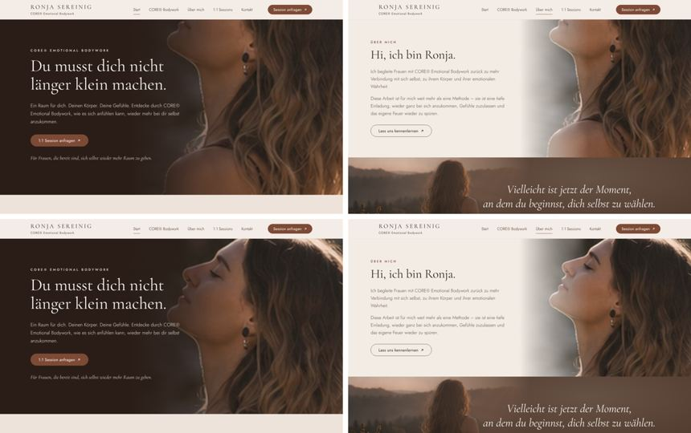
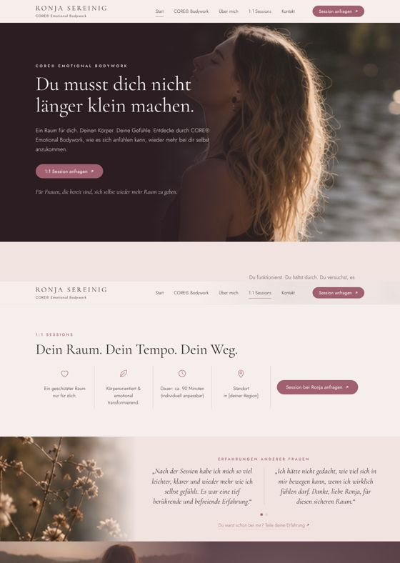
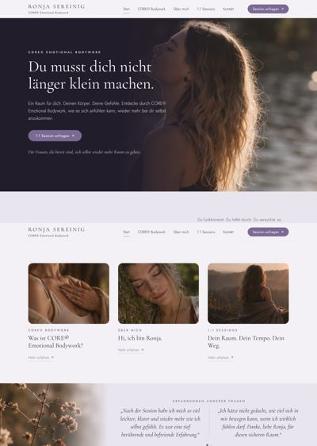
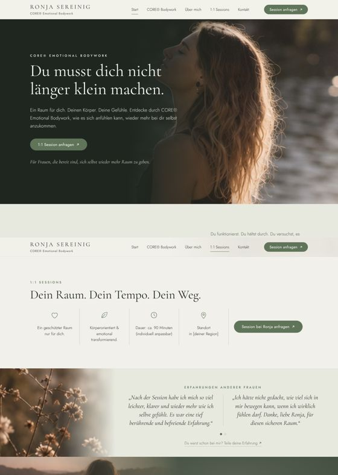
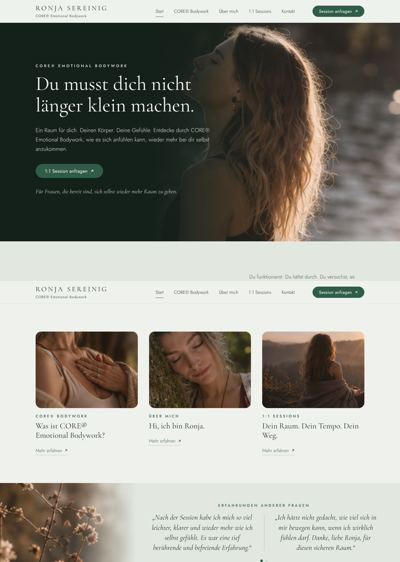
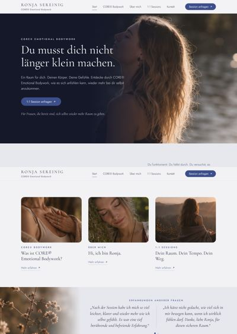
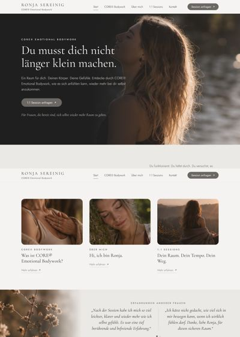

# Handbuch für deine Website

Liebe Ronja, mit diesem Handbuch kannst du alles rund um deine Website selbst erledigen: einrichten, Texte und Bilder ändern, eine eigene Domain verbinden, das Design anpassen und größere Umbauten machen.

**Keine Angst vor Fehlern:** Jede Änderung wird gespeichert. Du kannst alles wieder rückgängig machen (siehe [Kapitel 9](#9-etwas-rückgängig-machen)).

---

## Das Wichtigste in Kürze

### Du musst nie programmieren
Deine Website ist fertig aufgebaut. **Alles, was du im Alltag brauchst, machst du im Editor**, ganz ohne Code:

- Texte und Bilder auf allen Seiten
- Bildausschnitt und eigene Bilder pro Seite
- Namen der Menüpunkte und zusätzliche Textbereiche
- Erfahrungsberichte und Session-Merkmale
- **Seiten per Häkchen ein- und ausblenden**
- **Zusatzfunktionen per Häkchen ein- und ausschalten:** Preise, häufige Fragen, Online-Kalender-Button, Bildergalerie, zweites Bild, Video-Erfahrungen und die Seite Workshops
- Farben, Schrift und Gestaltung
- E-Mail, Telefon, Instagram und Google-Text
- Impressum und Datenschutzerklärung

Am Code musst du nur dann etwas ändern, **wenn du etwas möchtest, das es noch gar nicht gibt**, z. B. eine weitere neue Seite oder einen ganz neuen Bereich. Auch dafür musst du nicht programmieren können: Das erledigt Claude für dich ([Kapitel 7](#7-größere-änderungen-mit-ki-claude)).

### Einrichtung in 4 Schritten (einmalig, ca. 15 Minuten)
| | Schritt | Wo |
|:---:|---|---|
| **1** | Kostenloses **GitHub-Konto** anlegen | github.com |
| **2** | Die **Vorlage übernehmen** mit „Use this template“ | Link zur Vorlage |
| **3** | **Veröffentlichen einschalten**: Settings → Pages → „GitHub Actions“, danach einmal „Run workflow“ | dein Repository auf GitHub |
| **4** | Den **Editor (Pages CMS) verbinden** | app.pagescms.org |

Danach ist deine Website online, und du arbeitest nur noch im Editor. Die genaue Anleitung mit allen Klicks steht in [Kapitel 2](#2-einmalige-einrichtung).

**Später, wenn du möchtest:**
- Feedback-Formular aktivieren ([Kapitel 4](#4-feedback-von-kundinnen)), 2 Minuten
- Eigene Domain verbinden ([Kapitel 5](#5-schönere-web-adresse-und-eigene-domain))

---

## Inhalt

- [Das Wichtigste in Kürze](#das-wichtigste-in-kürze)
1. [So funktioniert deine Website](#1-so-funktioniert-deine-website)
2. [Einmalige Einrichtung](#2-einmalige-einrichtung)
3. [Texte und Bilder bearbeiten](#3-texte-und-bilder-bearbeiten)
4. [Feedback von Kundinnen](#4-feedback-von-kundinnen)
5. [Schönere Web-Adresse und eigene Domain](#5-schönere-web-adresse-und-eigene-domain)
6. [Farben und Design selbst ändern](#6-farben-und-design-selbst-ändern)
7. [Größere Änderungen mit KI (Claude)](#7-größere-änderungen-mit-ki-claude)
8. [Wenn etwas nicht funktioniert](#8-wenn-etwas-nicht-funktioniert)
9. [Etwas rückgängig machen](#9-etwas-rückgängig-machen)
10. [Sicherungskopie herunterladen](#10-sicherungskopie-herunterladen)
11. [Überblick: Konten und Kosten](#11-überblick-konten-und-kosten)
12. [Repository privat stellen (optional)](#12-repository-privat-stellen-optional)

---

## 1. So funktioniert deine Website

Deine Website besteht aus drei Teilen. Du musst nur den ersten regelmäßig benutzen:

| Was | Wofür | Wo |
|---|---|---|
| **Pages CMS** | Der **Editor**: Hier änderst du Texte und Bilder. | app.pagescms.org |
| **GitHub** | Der **Speicher**: Hier liegen alle Dateien. GitHub veröffentlicht deine Website automatisch und kostenlos. | github.com |
| **Web3Forms** | Leitet **Feedback** von Kundinnen an deine E-Mail-Adresse weiter. | web3forms.com |

**Der Ablauf ist immer gleich:** Du änderst etwas in Pages CMS und klickst auf **Speichern**. GitHub baut die Website neu, und nach 1–2 Minuten ist die Änderung online.

---

## 2. Einmalige Einrichtung

Dauer: ca. 15 Minuten. Du machst das nur ein einziges Mal.

### Schritt 1 – GitHub-Konto anlegen
1. Öffne **https://github.com/signup**
2. Gib deine E-Mail-Adresse, ein Passwort und einen **Benutzernamen** ein, z. B. `ronja-sereinig`.
   💡 Der Benutzername steht in deiner kostenlosen Web-Adresse (`benutzername.github.io`). Wähle also etwas, das zu dir passt.
3. Bestätige deine E-Mail-Adresse mit dem Code, den GitHub dir schickt.

### Schritt 2 – Deine eigene Kopie der Website erstellen
1. Öffne den Link zur Vorlage, den du bekommen hast.
2. Klicke oben rechts auf den grünen Button **„Use this template“** → **„Create a new repository“**.
3. Bei **Repository name** trägst du `website` ein. Wenn du gleich die schönere Adresse willst, siehe [Kapitel 5](#5-schönere-web-adresse-und-eigene-domain).
4. **Public** ausgewählt lassen. Das ist nötig, damit das Veröffentlichen kostenlos ist.
   ⚠️ **Stell das Repository später nicht auf „Private“.** Mit dem kostenlosen GitHub-Konto geht deine Website dann sofort offline. „Public“ heißt nur, dass man die Dateien deiner Website sehen kann, also Texte, Bilder und Design, die ohnehin online stehen. **Ändern kannst nur du.** Lege dort einfach nichts Privates ab, z. B. Kundinnendaten. Feedback kommt nur per E-Mail zu dir und landet nicht im Repository. Wenn du es trotzdem privat möchtest, siehe [Kapitel 12](#12-repository-privat-stellen-optional).
5. Klicke auf **„Create repository“**.

### Schritt 3 – Veröffentlichen einschalten
1. Klicke in deinem neuen Repository oben auf **„Settings“** (Zahnrad).
2. Klicke links auf **„Pages“**.
3. Wähle bei **„Source“** den Eintrag **„GitHub Actions“**.
4. Klicke oben auf **„Actions“**, dann links auf **„Website veröffentlichen“**, rechts auf **„Run workflow“** und dann auf den grünen Button **„Run workflow“**.
5. Nach 1–2 Minuten erscheint ein grüner Haken ✅.
   Ein roter Fehler ❌ von *vor* Schritt 3 ist normal und kann ignoriert werden.

Deine Website ist jetzt online unter **`https://DEIN-BENUTZERNAME.github.io/website/`**

### Schritt 4 – Den Editor verbinden
1. Öffne **https://app.pagescms.org**
2. Klicke auf **„Sign in with GitHub“** und erlaube den Zugriff.
3. Wenn du gefragt wirst, installiere die **GitHub App**. Wähle dabei dein Konto und dein Repository `website` aus.
4. Wähle dein Repository `website` aus.

🎉 Geschafft! Lege dir **app.pagescms.org** als Lesezeichen an. Das ist ab jetzt dein Arbeitsplatz.

### Erste Aufgaben (Checkliste)
- [ ] Eigene Fotos statt der Platzhalter hochladen
- [ ] E-Mail-Adresse unter **Einstellungen** eintragen
- [ ] Bei **1:1 Sessions** den Standort „[deiner Region]“ ersetzen
- [ ] **Impressum** und **Datenschutzerklärung** vollständig ausfüllen
- [ ] Formular-Schlüssel eintragen ([Kapitel 4](#4-feedback-von-kundinnen))
- [ ] Klären, ob du „CORE®“ so auf deiner Website verwenden darfst (Markenzeichen deines Ausbildungsanbieters)

---

## 3. Texte und Bilder bearbeiten

So öffnest du den Editor: **app.pagescms.org** → mit GitHub anmelden → Repository `website` auswählen.

Deine Website hat **6 Seiten**, die oben im Menü in dieser Reihenfolge stehen: **Start**, **Über mich**, **1:1 Sessions**, **Erfahrungen & Feedbacks**, **CORE® Bodywork** und **Kontakt**. Die Seite **Workshops** erscheint, wenn du sie einschaltest, zwischen „Erfahrungen & Feedbacks“ und „CORE® Bodywork“. Eine sechste Seite, **Workshops**, ist vorbereitet und lässt sich per Häkchen einschalten. Dazu kommen die Feedback-Seite, das Impressum und die Datenschutzerklärung (unten im Fußbereich).

Im Editor siehst du links:

| Menüpunkt | Was du dort änderst |
|---|---|
| **Seite: Start** | großer Einstieg mit Bild ganz oben und Einleitung (Frage & Text) |
| **Seite: Über mich** | Text, Bild und Button der Über-mich-Seite; optional Zusatzbereich, zweites Bild und Bildergalerie |
| **Seite: 1:1 Sessions** | Überschrift, Merkmale mit Symbolen, Button; optional Online-Kalender, Preise, häufige Fragen, Zusatzbereich, Reihenfolge |
| **Seite: Erfahrungen & Feedbacks** | eigene Seite mit allen Zitaten von Kundinnen, Videos und einer Einladung zum Feedback; per Häkchen auch auf Startseite und Sessions-Seite |
| **Seite: Workshops** | eigene Seite für Workshops (ein-/ausschaltbar), aufgebaut wie „Über mich“ |
| **Seite: CORE® Bodywork** | Text, Bild und Button der CORE-Seite, optional ein Zusatzbereich mit mehr Text |
| **Seite: Kontakt** | Text und Button der Kontaktseite |
| **Abschluss-Bereich (dunkler Bereich unten)** | der Satz mit Bild unten auf den Seiten („Vielleicht ist jetzt der Moment …“) |
| **Design (Farben & Schrift)** | Farbpalette, Schrift, Feinschliff (Textgröße, Buttons, Abstände …) und eigene Farben ([Kapitel 6](#6-farben-und-design-selbst-ändern)) |
| **Feedback-Seite** | Texte der Seite, auf der Kundinnen Feedback schreiben |
| **Impressum** / **Datenschutzerklärung** | die rechtlichen Seiten |
| **Einstellungen** | Name, E-Mail, Telefon, Instagram, Google-Text, Formular-Schlüssel |

### Texte ändern
1. Klicke in ein Feld und schreibe.
   - **Enter** = neue Zeile
   - **Leerzeile** (zweimal Enter) = neuer Absatz
2. Klicke auf **Speichern**.
3. Nach 1–2 Minuten deine Website neu laden. Die Änderung ist sichtbar.

💡 **Texte dürfen so lang sein, wie du möchtest.** Die Seite passt sich automatisch an, auch auf dem Handy.

💡 **Name im Menü ändern:** Jede Seite hat oben das Feld **„Name im Menü“**. Was du dort einträgst, steht oben im Menü, z. B. „Über mich“ statt „Über Ronja“.

💡 **Mehr Text auf einer Seite:** Bei **CORE® Bodywork**, **Über mich** und **1:1 Sessions** gibt es einen **Zusatzbereich** (Überschrift + Text). Er erscheint unter dem Hauptbereich, z. B. für deinen Werdegang, den Ablauf einer Session oder Preise. Felder leer lassen = kein Zusatzbereich.

💡 **Einen Button ausblenden:** Den Button-Text leer lassen. Das geht bei **CORE® Bodywork** und **Über mich**.

💡 **Wohin ein Button führt:** Im Feld **Button-Link** trägst du die Seite ein: `/kontakt/`, `/sessions/`, `/ueber-mich/`, `/core-bodywork/` oder eine volle Web-Adresse.

💡 **Erfahrungsberichte ausblenden:** Alle Einträge löschen.

💡 **Ein Bild weglassen:** Bild im Feld entfernen und speichern. Der Bereich wird dann einfach ohne Bild angezeigt.

💡 **Die Kacheln auf der Startseite** (unter der Einleitung) führen zu CORE® Bodywork, Über mich und 1:1 Sessions. Sie zeigen automatisch das Bild und die Überschrift der jeweiligen Seite. Das Bild für die Sessions-Kachel stellst du unter **Seite: 1:1 Sessions** ein.

### Bilder austauschen
1. Klicke beim gewünschten Bild auf das Bild-Feld.
2. Lade ein neues Foto hoch oder wähle eines, das du schon hochgeladen hast.
3. Fülle die **Bildbeschreibung** aus, z. B. „Ronja sitzt am See“. Das hilft blinden Menschen und Google.
4. **Speichern**.

### Welches Bild erscheint wo?

| Bild auf der Website | Wo du es einstellst |
|---|---|
| Großes Bild ganz oben auf der **Startseite** | **Seite: Start** → Großer Einstieg → Bild |
| Bild auf der Seite **CORE® Bodywork** (und in der Kachel auf der Startseite) | **Seite: CORE® Bodywork** → Bild |
| Bild auf der Seite **Über mich** (und in der Kachel auf der Startseite) | **Seite: Über mich** → Bild |
| Bild der Kachel **1:1 Sessions** auf der Startseite | **Seite: 1:1 Sessions** → Bild für die Kachel |
| Bild oben auf der Seite **Erfahrungen** (auch neben den Zitaten auf der Startseite) | **Seite: Erfahrungen & Feedbacks** → Bild |
| Bild im dunklen **Abschluss-Bereich** unten | **Abschluss-Bereich** → Bild *(gilt für alle Seiten)* |
| **Zweites Bild** auf Über mich / Workshops | **Seite: Über mich** bzw. **Seite: Workshops** → Zweites Bild |
| Fotos der **Bildergalerie** | **Seite: Über mich** bzw. **Seite: Workshops** → Bildergalerie: Fotos |
| **Vorschaubilder** der Videos | **Seite: Erfahrungen & Feedbacks** → Videos → Vorschaubild |

**Jede Seite individuell gestalten:** Die Bilder der Erfahrungsberichte und des Abschluss-Bereichs gelten zunächst für alle Seiten. Möchtest du auf einer Seite ein **anderes Bild**, öffne diese Seite im Editor, z. B. **Seite: Über mich**. Ganz unten findest du:
- **„Eigenes Bild für den Abschluss-Bereich (optional)“**, das es auf Start, CORE® Bodywork, Über mich und 1:1 Sessions gibt
- **„Eigenes Bild für die Erfahrungsberichte (optional)“**, das es auf Start und 1:1 Sessions gibt

Ein Bild eintragen heißt: Nur diese Seite bekommt dieses Bild. Feld **leer lassen** heißt: Es gilt das gemeinsame Bild.

### Hochkant-Fotos und Bildausschnitt
Du kannst **Quer- und Hochkant-Fotos** verwenden. Die Website verzerrt nichts. Sie **schneidet das Foto aber zu**, damit es in den Bildbereich passt. Die meisten Bildbereiche sind breit. Bei einem Hochkant-Foto ist deshalb nur ein Teil davon zu sehen, standardmäßig **die Mitte**.

Damit z. B. bei einem Porträt nicht der Kopf abgeschnitten wird, gibt es bei jedem Bild im Editor das Feld **„Bildausschnitt“**. Dort wählst du, **welcher Teil des Fotos sichtbar bleiben soll**. Stell dir dafür ein Raster mit 9 Feldern über dem Foto vor:

| | | |
|:---:|:---:|:---:|
| ↖ Oben links | ↑ **Oben** | ↗ Oben rechts |
| ← Links | ● **Mitte** *(Standard)* | → Rechts |
| ↙ Unten links | ↓ **Unten** | ↘ Unten rechts |

**So gehst du vor:**
1. Schau dir dein Foto an: Wo ist das Wichtigste, z. B. das Gesicht?
2. Wähle im Feld **„Bildausschnitt“** die passende Position, z. B. **„Oben“** bei einem Hochkant-Porträt, oder **„Oben links“**, wenn das Gesicht oben links im Foto ist.
3. **Speichern** und nach 1–2 Minuten auf der Website prüfen, **am Computer und am Handy**.
4. Passt es noch nicht ganz, probier die Nachbar-Position.

**Optional: Hilfsseite zum Finden der richtigen Position**
Eingestellt wird der Bildausschnitt **immer im Editor**. Wenn du dir unsicher bist, welche der 9 Positionen passt, hilft dir eine kleine Seite auf deiner Website. Sie zeigt dir die passende Position, ohne dass du speichern und warten musst:
1. Öffne **`https://DEINE-ADRESSE/bildausschnitt/`**. Die Seite steht nicht im Menü und erscheint nicht bei Google. Leg sie dir am besten als Lesezeichen an.
2. Wähle das Bild aus: eines deiner Website-Bilder oder ein Foto von deinem Gerät. Das Foto vom Gerät wird dabei nirgends hochgeladen.
3. Klick im Bild auf die Stelle, die sichtbar bleiben soll. Das Bild ist in dieselben 9 Felder aufgeteilt wie die Auswahl im Editor.
4. Die Seite zeigt dir, **was du im Editor auswählen sollst**, z. B. **„↖ Oben links“**, und eine **Vorschau**, wie das Bild am Computer, am Handy und als Kachel aussieht.
5. Genau diese Position wählst du dann in Pages CMS im Feld **„Bildausschnitt“** und **speicherst**.

💡 Ein neu hochgeladenes Bild erscheint auf der Hilfsseite erst nach 1–2 Minuten. Du kannst es aber sofort über **„Foto vom Gerät wählen“** prüfen.

*Oben im Beispiel: Bildausschnitt „Mitte“, der Kopf ist abgeschnitten. Unten: „Oben“, das Gesicht ist sichtbar.*

💡 Am schönsten wirken **Querformat-Fotos**, weil sie fast vollständig zu sehen sind. Schau dir nach dem Speichern die Seite immer kurz **am Computer und am Handy** an, denn der Ausschnitt ist dort etwas unterschiedlich.

**So werden deine Fotos schön:**

| Tipp | Warum |
|---|---|
| **Querformat**, mind. **1800 px** breit | Die Bilder sind auf großen Bildschirmen sehr breit. |
| Vorher verkleinern, unter **1 MB**, z. B. mit **squoosh.app** (kostenlos, im Browser) | Die Seite lädt schneller, besonders am Handy. |
| Warmes, natürliches Licht | Das passt zu den Farben der Seite. |
| **Großes Bild ganz oben:** Person eher **rechts** im Bild | Links liegt der Text darüber. |
| **Seite CORE® Bodywork:** Motiv eher **links** | Das Bild läuft nach rechts weich aus. |
| **Seite Über mich:** Motiv eher **rechts** | Das Bild läuft nach links weich aus. |

### Mehr Einträge hinzufügen
Bei Listen kannst du beliebig viele Einträge **hinzufügen**, **löschen** und **verschieben**: Session-Merkmale, Erfahrungsberichte, Videos, Preise, häufige Fragen und Galerie-Fotos. Für jedes Session-Merkmal wählst du ein passendes Symbol aus.

### Seiten ein- und ausblenden
Jede Seite hat im Editor **ganz oben** das Häkchen **„Seite anzeigen“**:
- **Angehakt:** Die Seite ist online, steht im Menü und, falls vorhanden, als Kachel auf der Startseite.
- **Nicht angehakt:** Die Seite verschwindet von der Website. Deine Texte und Bilder bleiben gespeichert. Mit einem Häkchen ist sie jederzeit wieder da.

Das geht bei: **Über mich**, **1:1 Sessions**, **Erfahrungen & Feedbacks**, **Workshops**, **CORE® Bodywork**, **Kontakt** und der **Feedback-Seite**.

💡 Kein Button führt ins Leere. Führt ein Button zu einer ausgeblendeten Seite, geht er automatisch zur **Kontaktseite**. Ist auch die Kontaktseite ausgeblendet, öffnet er eine **E-Mail an dich**. Trag dafür deine E-Mail-Adresse unter **Einstellungen** ein.

💡 Ist die **Feedback-Seite** ausgeblendet, verschwinden auch alle Links zum Feedback.

💡 Die **Startseite** kann man nicht ausblenden, sie ist deine Website. **Impressum** und **Datenschutzerklärung** bleiben immer sichtbar, weil sie gesetzlich vorgeschrieben sind.

### Zusatzfunktionen ein- und ausschalten
Diese Bereiche sind schon fertig eingebaut. Du schaltest sie mit einem **Häkchen** ein oder aus. Ausgeschaltet sind sie auf der Website unsichtbar, deine Texte und Bilder bleiben aber gespeichert.

| Funktion | Wo im Editor | Häkchen |
|---|---|---|
| **Preise**: Angebote mit Titel, Preis und Beschreibung, eines davon hervorhebbar | Seite: 1:1 Sessions | „Preise: Bereich anzeigen“ |
| **Häufige Fragen**: aufklappbare Fragen & Antworten | Seite: 1:1 Sessions | „Häufige Fragen: Bereich anzeigen“ |
| **Online-Kalender**: zusätzlicher Button, z. B. zu Calendly | Seite: 1:1 Sessions | „Online-Kalender: Button anzeigen“ und Link eintragen |
| **Erfahrungen auf der Startseite**: Zitate zum Durchblättern | Seite: Erfahrungen & Feedbacks | „Auf der Startseite zeigen“ |
| **Erfahrungen auf der Sessions-Seite** | Seite: Erfahrungen & Feedbacks | „Auf der Seite 1:1 Sessions zeigen“ (und bei Seite: 1:1 Sessions optional „Erfahrungsberichte vor den Sessions zeigen“) |
| **Zweites Bild**: neben dem Zusatzbereich | Seite: Über mich (auch Workshops) | „Zweites Bild: anzeigen“ |
| **Bildergalerie**: beliebig viele Fotos, mit Klick groß ansehen | Seite: Über mich (auch Workshops) | „Bildergalerie: anzeigen“ |
| **Seite Workshops**: eigene Seite mit Menüpunkt und Kachel auf der Startseite | Seite: Workshops | „Seite anzeigen“ |
| **Kontaktformular**: Besucher schreiben dir direkt auf der Website, du bekommst eine E-Mail ([Kapitel 4](#4-feedback-von-kundinnen)) | Seite: Kontakt | „Kontaktformular anzeigen“ |
| **Video-Erfahrungen**: Videos von YouTube auf der Seite Erfahrungen ([Kapitel 4](#4-feedback-von-kundinnen)) | Seite: Erfahrungen & Feedbacks | „Videos: anzeigen“ |

💡 Die Bereiche sind schon mit **Beispieltexten** gefüllt, z. B. Preise mit „[Preis] €“ und Fragen mit „Hier steht deine Antwort.“ Ersetze sie, **bevor** du das Häkchen setzt.

💡 **Zweites Bild:** Es erscheint neben dem **Zusatzbereich** (Felder „Zusatzbereich – Überschrift/Text“). Trag dort also auch einen Text ein, z. B. „Mein Weg“.

### Was der Editor *nicht* kann
Für Dinge, die es auf deiner Website **noch gar nicht gibt**, brauchst du Hilfe, z. B.:
- eine **weitere neue Seite**, zusätzlich zu Workshops, z. B. „Retreats“
- einen **ganz neuen Bereich**, z. B. eine Newsletter-Anmeldung
- die **Reihenfolge** von Bereichen frei ändern (außer „Erfahrungen zuerst“ bei den Sessions)

Das geht ganz einfach mit KI, siehe [Kapitel 7](#7-größere-änderungen-mit-ki-claude).

### Für Google
Unter **Einstellungen** kannst du festlegen:
- **Seitentitel:** Er steht im Browser-Tab und bei Google.
- **Beschreibung für Google:** ca. 150 Zeichen. Sie erscheint in den Suchergebnissen.
- **Vorschaubild beim Teilen:** Es erscheint, wenn jemand deinen Link per WhatsApp oder Facebook teilt.

---

## 4. Feedback von Kundinnen

**Zwei Seiten, zwei Aufgaben (nicht doppelt!):**

| | Erfahrungen & Feedbacks | Feedback-Seite |
|---|---|---|
| Wofür? | Hier **zeigst** du Zitate und Videos von Kundinnen. | Hier **schreiben** Kundinnen dir anonym ein neues Feedback. |
| Adresse | `/erfahrungen/` | `/feedback/` |
| Im Menü? | Ja | Nein, nur unten auf der Seite und als Button |
| Wer sieht es? | Alle Besucher | Nur du, per E-Mail |

So hängen sie zusammen: Kundin schreibt auf der Feedback-Seite → du bekommst eine E-Mail → gefällt es dir, trägst du es unter **Seite: Erfahrungen & Feedbacks** ein → jetzt sehen es alle.

Auf deiner Website gibt es die Seite **`/feedback/`**. Dort können Kundinnen **anonym und ohne Anmeldung** schreiben, wie sie die Session erlebt haben.

### Einmalig aktivieren (2 Minuten)
1. Öffne **https://web3forms.com** und klicke auf **„Create your Access Key“**.
2. Gib die E-Mail-Adresse ein, an die das Feedback geschickt werden soll.
3. Du bekommst per E-Mail einen **Schlüssel**, eine lange Buchstaben-Zahlen-Kombination. Kopiere ihn.
4. Füge ihn in Pages CMS unter **Einstellungen → Formular-Schlüssel** ein und klicke auf **Speichern**.

Solange kein Schlüssel eingetragen ist, zeigt die Seite einen freundlichen Hinweis statt des Formulars.

Der Schlüssel gilt für **beide** Formulare: das Feedback-Formular und das Kontaktformular.

### Das Kontaktformular
Auf der Kontaktseite können Besucher dir direkt schreiben: Name, E-Mail, freiwillig Telefon und eine Nachricht. Du bekommst alles **per E-Mail**. Klick in der E-Mail auf **Antworten**, dann geht deine Antwort automatisch an die Person.

- **Ein-/ausschalten:** Seite: Kontakt → „Kontaktformular anzeigen“. Ohne Formular gibt es nur den Button „E-Mail schreiben“.
- **Kein Telefonfeld:** Häkchen bei „Formular: Telefonfeld anzeigen“ entfernen.
- **Texte ändern:** alle Felder, die mit „Formular:“ beginnen.
- Ohne Formular-Schlüssel zeigt die Kontaktseite automatisch den E-Mail-Button.

### So läuft es danach
- Schick Kundinnen nach der Session den Link: `https://DEINE-ADRESSE/feedback/`
- Jedes Feedback kommt **per E-Mail** bei dir an. Es erscheint **nicht automatisch** auf der Website. Du entscheidest, was online geht.
- In der E-Mail steht unter **„Veröffentlichung“**, was die Kundin ausgewählt hat:
  - **Nein, nur für dich** → bitte nicht auf die Website stellen.
  - **Ja, aber anonym** → du darfst es zeigen. Lass das Feld **Name** leer.
  - **Ja, gern mit Vornamen/Initialen** → trag beim Erfahrungsbericht im Feld **Name** genau das ein, was sie im Formular angegeben hat.
- Mit Namen zeigst du ein Feedback nur, wenn sie das so ausgewählt hat. Im Zweifel lieber anonym. Bewahre die E-Mail als Nachweis auf.
- Wenn ja und du es zeigen möchtest: In Pages CMS unter **Seite: Erfahrungen & Feedbacks** einen neuen Erfahrungsbericht hinzufügen, den Text hineinkopieren und speichern.

💡 Kostenlos sind 250 Feedbacks pro Monat. Das reicht in der Regel völlig.

### Video-Erfahrungen zeigen (optional)
Deine Website kann Video-Erfahrungen von YouTube zeigen, auf der Seite **Erfahrungen**.

**⚠️ Vorher wichtig: Einwilligung einholen**
Bei einem Video ist die Kundin erkennbar, das Feedback ist also **nicht mehr anonym**. Lass dir **schriftlich** bestätigen, dass du das Video auf deiner Website und auf YouTube zeigen darfst. Eine kurze E-Mail von ihr reicht, z. B.: „Ich bin einverstanden, dass Ronja mein Video auf ihrer Website und auf YouTube veröffentlicht.“ Bewahre diese E-Mail auf.

**So geht's:**
1. Lade das Video auf **YouTube** hoch und stell die Sichtbarkeit auf **„Nicht gelistet“**. Dann findet man es nicht über die YouTube-Suche, nur über deine Website.
2. Kopiere bei YouTube unter **„Teilen“** den Link, z. B. `https://youtu.be/abc123…`.
3. In Pages CMS unter **Seite: Erfahrungen & Feedbacks** bei **Videos** einen Eintrag hinzufügen und den Link einfügen. Optional kannst du einen **Titel** („Anna erzählt …“) und ein eigenes **Vorschaubild** angeben.
4. Häkchen bei **„Videos: anzeigen“** setzen und **speichern**.

**Datenschutz ist eingebaut:** Beim Öffnen deiner Website wird **nichts** von YouTube geladen. Besucherinnen sehen zuerst nur eine Fläche mit Play-Symbol und einem kurzen Hinweis. Erst beim Klick wird das Video im datenschutzfreundlichen Modus von YouTube geladen. Ein passender Abschnitt steht bereits in deiner Datenschutzerklärung.

💡 Ein ungültiger Link wird einfach nicht angezeigt. Die Website geht dadurch nicht kaputt.

---

## 5. Schönere Web-Adresse und eigene Domain

### Möglichkeit A: Kostenlos und kürzer
Statt `https://ronja-sereinig.github.io/website/` kann deine Adresse auch `https://ronja-sereinig.github.io` lauten.

1. Auf GitHub in deinem Repository: **Settings → General**
2. Ganz oben bei **Repository name** genau eintragen: **`DEIN-BENUTZERNAME.github.io`**
   (Beispiel: Benutzername `ronja-sereinig` → `ronja-sereinig.github.io`)
3. **Rename** klicken.
4. **Neu veröffentlichen:** **Actions → „Website veröffentlichen“ → „Run workflow“ → „Run workflow“**
5. Nach 1–2 Minuten ist deine Website unter der neuen Adresse erreichbar.

💡 Den Benutzernamen kannst du unter **github.com → dein Profilbild → Settings → Account → Change username** ändern. Danach musst du auch den Repository-Namen anpassen.

### Möglichkeit B: Eigene Domain, z. B. `ronja-sereinig.at`
Kosten: ca. 10–20 € pro Jahr. Das wirkt am professionellsten, z. B. auf Visitenkarten oder Instagram.

**Schritt 1 – Domain kaufen**
Bei einem Domain-Anbieter, z. B. **World4You**, **easyname**, **IONOS** oder **INWX**. Es reicht die Domain allein, du brauchst **kein Webhosting-Paket**.
💡 Viele Anbieter bieten auch eine passende E-Mail-Adresse an, z. B. `hallo@ronja-sereinig.at`. Das ist praktisch und wirkt professionell.

**Schritt 2 – Beim Domain-Anbieter die DNS-Einträge setzen**
Suche in deinem Kundenbereich nach **„DNS“**, **„DNS-Einstellungen“** oder **„Nameserver-Einträge“**. Lege diese Einträge an. Falls dort schon andere **A-Einträge** für „@“ stehen, lösche diese vorher.

| Typ | Name / Host | Wert / Ziel |
|---|---|---|
| A | @ | 185.199.108.153 |
| A | @ | 185.199.109.153 |
| A | @ | 185.199.110.153 |
| A | @ | 185.199.111.153 |
| CNAME | www | `DEIN-BENUTZERNAME.github.io` |

💡 Wenn du unsicher bist: Schick dem Support deines Domain-Anbieters diese Tabelle und schreib dazu: „Bitte die Domain auf GitHub Pages zeigen lassen.“ Die machen das täglich.

**Schritt 3 – Auf GitHub eintragen**
1. Im Repository: **Settings → Pages**
2. Bei **Custom domain** deine Domain eintragen, z. B. `ronja-sereinig.at`, und **Save** klicken.
3. Warten, bis GitHub die Domain prüft. Das dauert von ein paar Minuten bis zu 24 Stunden.
4. Wenn möglich, Häkchen bei **„Enforce HTTPS“** setzen. Dann hat deine Seite das Schloss-Symbol 🔒.

**Schritt 4 – ⚠️ Neu veröffentlichen (wichtig!)**
**Actions → „Website veröffentlichen“ → „Run workflow“ → „Run workflow“**
Ohne diesen Schritt fehlen auf der neuen Domain Bilder und Design.

**Danach:** Den Link überall aktualisieren, z. B. auf Instagram, Google-Profil und Visitenkarten. Den Feedback-Link schickst du ab dann als `https://ronja-sereinig.at/feedback/`.

---

## 6. Farben und Design selbst ändern

Farben, Schrift und Gestaltung änderst du genauso einfach wie Texte, direkt im Editor unter **„Design (Farben & Schrift)“**.

**Der Ablauf ist immer gleich:** auswählen → **Speichern** → nach 1–2 Minuten hat deine ganze Website das neue Aussehen. Gefällt es dir nicht, wählst du einfach wieder die vorherige Einstellung und speicherst.

Die Einstellungen sind in **drei Stufen** aufgebaut. Für eine schöne Website reicht **Stufe 1** völlig aus.

### Stufe 1: Farbpalette und Schrift (das Wichtigste)

**Farbpalette:** Jede Palette ändert **alle Farben auf einmal**: Hintergründe, Text, Buttons, Symbole und die dunklen Bereiche. Die Farben sind aufeinander abgestimmt, du kannst also nichts falsch kombinieren.

| **Erdtöne** | **Terrakotta** | **Pfirsich** | **Rosé** |
|:---:|:---:|:---:|:---:|
|  |  |  |  |
| warmes Braun *(Standard)* | warmes Orange-Rot | sanftes Apricot | zartes Altrosa |
| **Lavendel** | **Salbei** | **Olive** | **Waldgrün** |
|  |  |  |  |
| helles Violett | sanftes Grün | erdiges Gelbgrün | tiefes Grün |
| **Sand & Meer** | **Nachtblau** | **Creme & Gold** | **Stein** |
|  |  |  |  |
| Beige mit Blaugrau | kühles Blau | hell mit Goldton | schlichtes Grau |

**Schrift:** Jede Auswahl ist ein abgestimmtes Paar aus Überschrift und Text.

**Schriften frei kombinieren (optional):** Unter dem Schriftpaar findest du zwei weitere Felder:
- **„Schrift für Überschriften“**: 12 Schriften zur Auswahl
- **„Schrift für Text“**: 10 Schriften zur Auswahl

Steht dort **„Wie im Schriftpaar (Standard)“**, gilt das gewählte Paar. Wählst du eine eigene Schrift, ersetzt sie nur diesen Teil. So kannst du z. B. das Paar „Elegant“ nehmen und nur die Überschrift auf „Newsreader“ ändern. Alle Schriften werden direkt von deiner Website geladen, ohne Google.

| **Elegant *(Standard)*** | **Klassisch** | **Zeitlos** | **Modern** |
|:---:|:---:|:---:|:---:|
|  |  |  |  |
| **Edel** | **Weich** | **Ruhig** | **Schlicht** |
|  |  |  |  |

### Stufe 2: Feinschliff (optional)
Alle Felder, die mit **„Feinschliff:“** beginnen. Wenn du sie nicht anfasst, gilt der Standard.

| Einstellung | Auswahl |
|---|---|
| **Textgröße** | Klein · **Normal** · Groß (besser lesbar) |
| **Form der Buttons** | **Rund** · Leicht abgerundet · Eckig |
| **Ecken von Kacheln und Feldern** | **Rund** · Leicht abgerundet · Eckig |
| **Abstände** | Kompakt · **Normal** · Luftig |
| **Bilder neben Texten** | **Mit weichem Verlauf** · Ohne Verlauf (klare Kante) |

*(fett = Standard)*

Beispiel mit **eckigen Buttons und Kacheln, großer Schrift, kompakten Abständen und Bildern ohne Verlauf**:

### Stufe 3: Eigene Farben (optional)
Für eine ganz bestimmte Farbe, z. B. deine Logo-Farbe.

1. Auf **https://htmlcolorcodes.com** eine Farbe anklicken und den Code kopieren. Er beginnt mit `#` und hat 6 Zeichen, z. B. `#5e6b4f`.
2. Im Editor ins passende Feld einfügen und **speichern**:

| Feld | Was sich ändert |
|---|---|
| **Eigene Farbe: Akzentfarbe** | Buttons, kleine Überzeilen, Symbole, Links |
| **Eigene Farben: weitere → Hintergrund** | heller Haupt-Hintergrund |
| **… → Zweiter Hintergrund** | etwas dunklerer Hintergrund für abwechselnde Bereiche |
| **… → Textfarbe** | Überschriften und Text |
| **… → Dunkle Bereiche** | großer Einstieg oben, Abschluss-Bereich und Fußbereich |

- Jedes Feld ist **einzeln** optional. **Leer lassen** = Farbe der gewählten Palette.
- Der Editor nimmt nur gültige Farbcodes an. Ein Tippfehler kann deine Website also nicht beschädigen.

💡 **Tipps für eigene Farben:**
- Fang mit einer **Palette** an, die deiner Wunschfarbe nahekommt, und ändere dann nur die **Akzentfarbe**. Das sieht fast immer stimmig aus.
- Hintergründe **hell**, Text und dunkle Bereiche **dunkel** wählen, sonst ist die Schrift schlecht lesbar.
- Auf Buttons steht weiße Schrift. Die Akzentfarbe sollte daher **kräftig genug** sein.

### Noch mehr anpassen?
Eine eigene neue Palette oder eine ganz andere Schrift baut dir Claude ein ([Kapitel 7](#7-größere-änderungen-mit-ki-claude)):
> „Füge im Design eine neue Farbpalette **‚Lavendel dunkel‘** hinzu (Datei `lib/design.js` und Auswahl in `.pages.yml`).“

> „Füge bei ‚Schrift für Überschriften‘ die Schrift **…** hinzu (über Fontsource, lokal ausgeliefert, in `lib/design.js` und `.pages.yml`).“

---

## 7. Größere Änderungen mit KI (Claude)

Für alles, was der Editor nicht kann, hilft dir eine KI wie **Claude**. Programmieren musst du dafür nicht. Du beschreibst in normalen Worten, was du möchtest. Claude ändert die Dateien direkt in deinem GitHub-Repository.

### So startest du
1. Öffne **https://claude.ai** und melde dich an. Ein kostenloses Konto reicht oft schon. Für größere Arbeiten an Dateien kann ein bezahltes Abo nötig sein.
2. Verbinde dein **GitHub-Konto** mit Claude. Claude fragt dich danach, wenn du ein Repository nennst.
3. Schreib zum Beispiel:

> Mein GitHub-Repository ist **DEIN-BENUTZERNAME/website**. Es ist eine Eleventy-Website mit Pages CMS als Editor (Konfiguration in `.pages.yml`) und wird über GitHub Actions auf GitHub Pages veröffentlicht. Bitte [deine Änderung]. Neue Inhalte sollen im Editor bearbeitbar sein, ergänze dafür auch `.pages.yml`. Halte dich an das bestehende Design.

### Beispiele, die du nur noch anpassen musst
Vieles ist schon eingebaut und nur per Häkchen einzuschalten (siehe [Kapitel 3](#zusatzfunktionen-ein--und-ausschalten)). Für alles Weitere zum Beispiel:
- „Lege eine weitere Seite **Retreats** an, nach dem Vorbild der Seite ‚Workshops‘ (ein-/ausschaltbar, mit Menüpunkt und eigenem Eintrag im Editor).“
- „Füge auf der Startseite einen Bereich **Newsletter-Anmeldung** hinzu (ein-/ausschaltbar im Editor).“
- „Füge bei ‚CORE® Bodywork‘ ebenfalls eine **Bildergalerie** hinzu, wie bei ‚Über mich‘.“
- „Füge einen Bereich mit **Zertifikaten / Ausbildungen** als Liste mit Logos hinzu.“
- „Mach die **Reihenfolge der Bereiche** auf der Startseite im Editor wählbar.“
- „Füge bei ‚Schrift für Überschriften‘ die Schrift **…** hinzu.“

### Tipps für gute Ergebnisse
- **Eine Änderung nach der anderen.** Kleine Schritte gehen fast immer gut.
- Bitte Claude, **vor dem Speichern zu prüfen**, ob alles funktioniert („Bitte teste den Build, bevor du speicherst“).
- Wenn dir etwas nicht gefällt, sag einfach: **„Mach die letzte Änderung rückgängig.“**
- Beschreibe genau, **wo** etwas hin soll, z. B. „unter dem Bereich Über mich“ oder „im Menü nach Kontakt“.
- Hast du einen Screenshot einer Website, die dir gefällt? Schick ihn mit: „So ähnlich soll es aussehen.“

---

## 8. Wenn etwas nicht funktioniert

| Problem | Lösung |
|---|---|
| **Meine Änderung ist nicht online.** | 1–2 Minuten warten. Dann die Seite mit **Strg + F5** neu laden (am Mac **Cmd + Shift + R**). |
| **Sie ist nach 5 Minuten immer noch nicht da.** | Auf GitHub im Repository auf **Actions** klicken. Hat der oberste Eintrag ein rotes ❌? Dann siehe nächste Zeile. |
| **Bei „Actions“ steht ein rotes ❌.** | Den Eintrag anklicken und rechts oben **„Re-run all jobs“** klicken. Klappt es wieder nicht, hat die letzte Änderung einen Fehler. Mach sie rückgängig ([Kapitel 9](#9-etwas-rückgängig-machen)) oder lass Claude den Fehler beheben: „Der Build in meinem Repository schlägt fehl, bitte prüfen und beheben.“ |
| **Bilder oder Design fehlen nach einem Domain-Wechsel.** | **Actions → „Website veröffentlichen“ → „Run workflow“** |
| **Das Feedback-Formular wird nicht angezeigt.** | Unter **Einstellungen** den Formular-Schlüssel prüfen. Er muss ganz und ohne Leerzeichen eingefügt sein. |
| **Es kommt kein Feedback per E-Mail an.** | Im Spam-Ordner nachsehen. Die E-Mails kommen von Web3Forms. |
| **Manche Seiten zeigen noch die alten Farben oder Texte, andere schon die neuen.** | Dein Browser zeigt noch eine gespeicherte Kopie (bis zu ca. 10 Minuten). **Strg + F5** drücken (am Mac **Cmd + Shift + R**) oder kurz warten. |
| **Ich kann mich bei Pages CMS nicht anmelden.** | Auf **github.com** einloggen, dann erneut auf app.pagescms.org „Sign in with GitHub“. Passwort vergessen? Auf github.com **„Forgot password?“** nutzen. |
| **Ein neuer Menüpunkt oder ein neues Feld erscheint nicht im Editor**, z. B. nachdem Claude etwas eingebaut hat. | Pages CMS merkt sich die alte Einstellung. In Pages CMS links auf **„Settings“** klicken (nicht „Einstellungen“). Dort ganz am Ende der Datei eine **leere Zeile** einfügen, **speichern** und die Seite neu laden. |
| **Ein Feld fehlt im Editor, auch nach dem Trick oben.** | Das Feld ist nicht in `.pages.yml` eingetragen. Bitte Claude, es zu ergänzen. |
| **Bei einem Foto ist der Kopf oder das Wichtigste abgeschnitten.** | Im Feld **„Bildausschnitt“** die Position wählen, an der das Wichtigste im Foto ist, z. B. „Oben“ ([Kapitel 3](#3-texte-und-bilder-bearbeiten)). |
| **Ein Bild sieht unscharf aus.** | Ein größeres Foto hochladen (mind. 1800 px breit). |
| **Ein Bild ist falsch zugeschnitten.** | Feld **„Bildausschnitt“** nutzen, oder ein Foto wählen, bei dem das Motiv auf der richtigen Seite ist. |

---

## 9. Etwas rückgängig machen

GitHub speichert **jede einzelne Version** jeder Datei.

### Einfachster Weg: Claude fragen
> „Bitte mach in meinem Repository **DEIN-BENUTZERNAME/website** die letzte Änderung rückgängig.“

### Selbst machen (für Texte)
1. Auf **github.com** dein Repository öffnen.
2. Die betroffene Datei öffnen. Die Texte liegen in **src → _data**, z. B. `start.json` (Startseite), `core.json`, `about.json` (Über mich), `sessions.json`, `contact.json` (Kontakt), `testimonials.json` (Erfahrungsberichte).
3. Rechts oben auf **„History“** klicken. Dort siehst du alle bisherigen Versionen mit Datum.
4. Eine ältere Version anklicken. So siehst du, was sich geändert hat, und kannst den alten Text herauskopieren.
5. Den alten Text in Pages CMS wieder einfügen und speichern.

---

## 10. Sicherungskopie herunterladen

Ab und zu, z. B. einmal im Jahr, eine Kopie auf dem eigenen Computer speichern:

1. Auf **github.com** dein Repository öffnen.
2. Grüner Button **„Code“** → **„Download ZIP“**.

Darin ist deine komplette Website mit allen Texten und Bildern.

---

## 11. Überblick: Konten und Kosten

| Dienst | Wofür | Kosten | Konto |
|---|---|---|---|
| GitHub | Speicher und Veröffentlichung | kostenlos | ja, dein eigenes |
| Pages CMS | Editor | kostenlos | Anmeldung mit GitHub |
| Web3Forms | Feedback-Formular | kostenlos bis 250 Feedbacks pro Monat | nein, nur der Schlüssel per E-Mail |
| Eigene Domain | schöne Adresse | ca. 10–20 € pro Jahr | beim Domain-Anbieter |
| GitHub Pro (optional) | privates Repository mit Website | ein paar $ pro Monat | dein GitHub-Konto |
| Cloudflare (optional) | kostenlose Alternative bei privatem Repository | kostenlos | ja |
| Claude | größere Änderungen | kostenloses Konto möglich, für größere Arbeiten evtl. Abo | ja |

**Wichtige Adressen (zum Abspeichern):**
- Editor: **https://app.pagescms.org**
- Dateien und Einstellungen: **https://github.com/DEIN-BENUTZERNAME/website**
- Deine Website: **https://DEIN-BENUTZERNAME.github.io/website/** oder deine eigene Domain
- Seite Erfahrungen: **…/erfahrungen/**
- Feedback-Seite: **…/feedback/**

---

## 12. Repository privat stellen (optional)

**Musst du das?** Nein. Dein Repository ist öffentlich, damit die Veröffentlichung kostenlos bleibt. Man kann dort nur das sehen, was ohnehin auf deiner Website steht: Texte, Bilder und Design. **Ändern kannst nur du.** Für die meisten Websites ist „öffentlich“ völlig in Ordnung.

Wenn du es trotzdem privat haben möchtest, ist das wichtig zu wissen:

> ⚠️ **Mit dem kostenlosen GitHub-Konto geht deine Website offline, sobald du das Repository auf „Private“ stellst.** GitHub veröffentlicht Websites aus privaten Repositories nur mit einem bezahlten Konto.

Es gibt zwei Möglichkeiten:

### Möglichkeit A: GitHub Pro (kostenpflichtig, am einfachsten)
Mit **GitHub Pro** bleibt deine Website online, auch wenn das Repository privat ist. Die Website selbst bleibt dabei für alle sichtbar, nur die Dateien sind versteckt. Pro kostet ein paar Dollar im Monat. Den aktuellen Preis siehst du auf github.com/pricing.

1. Auf **github.com** oben rechts auf dein **Profilbild → Settings**.
2. Links auf **Billing and licensing** bzw. **„Plans and usage“** → **GitHub Pro** auswählen und bezahlen.
3. **Erst danach** dein Repository öffnen → **Settings** → **General** → ganz nach unten zu **„Danger Zone“** → **„Change visibility“** → **„Make private“** → bestätigen.
4. Deine Website kurz aufrufen und prüfen, ob sie noch erreichbar ist. Falls nicht: **Actions → „Website veröffentlichen“ → „Run workflow“**.

⚠️ **Wichtig:**
- Die Reihenfolge einhalten: **zuerst Pro buchen, dann auf privat stellen.**
- Wenn du Pro später **kündigst**, geht deine Website offline. Stell das Repository dann vorher wieder auf **„Public“** (gleicher Weg wie oben, nur „Make public“).

### Möglichkeit B: Kostenlos über Cloudflare (aufwändiger)
Das Repository bleibt **privat** auf GitHub, veröffentlicht wird die Website aber kostenlos über **Cloudflare Pages** statt über GitHub. Der Editor (Pages CMS) funktioniert genauso wie bisher.

Dafür müssen ein paar technische Einstellungen geändert werden. Am einfachsten lässt du dir dabei von Claude helfen ([Kapitel 7](#7-größere-änderungen-mit-ki-claude)):

> Mein GitHub-Repository **DEIN-BENUTZERNAME/website** ist eine Eleventy-Website mit Pages CMS, die bisher über GitHub Actions auf GitHub Pages veröffentlicht wird. Ich möchte das Repository auf privat stellen und die Website stattdessen kostenlos über **Cloudflare Pages** veröffentlichen. Bitte passe das Repository an und erkläre mir Schritt für Schritt, was ich bei Cloudflare einstellen muss (Build-Befehl, Ausgabeordner, eigene Domain).

Grob läuft es so ab:
1. Kostenloses Konto auf **cloudflare.com** anlegen.
2. Bei Cloudflare unter **Workers & Pages** ein neues Projekt anlegen und dein GitHub-Repository verbinden.
3. Als Build-Befehl `npm run build` und als Ausgabeordner `_site` eintragen.
4. Deine Website ist dann unter `….pages.dev` erreichbar. Eine eigene Domain kannst du bei Cloudflare direkt verbinden.
5. **Erst wenn die Website über Cloudflare läuft**, das Repository auf GitHub auf **privat** stellen (siehe Schritt 3 bei Möglichkeit A). Danach unter **Settings → Pages** GitHub Pages abschalten.

💡 **Wenn du eine eigene Domain hast**, musst du deren DNS-Einträge von GitHub auf Cloudflare umstellen. Cloudflare zeigt dir dabei genau an, was einzutragen ist.

---

Viel Freude mit deiner Website! 🌿
